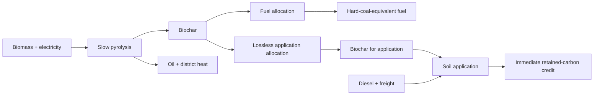

# BCR diffusion separation

The approved ZEN-europe-only correction is implemented. Both lossless allocation
and soil application reference `biochar_for_application`; pyrolysis still
references `biochar`. The new name is bookkeeping, not a different material or
heating value. No source coefficient or core equation changes.



The allocation step is 1 MWh in / 1 MWh out, with zero CAPEX, O&M and removal.
Its reference carrier is its downstream output, **not** ordinary biochar. Both
services have 100-year bookkeeping lifetimes, no existing capacity and no finite
diffusion limit. The new carrier has no imports, exports, storage or independent
credit. Application retains its diesel, freight, cost, removal and land parameters.

At every node/time, pyrolysis output equals fuel-route input plus allocation input;
allocation output equals application input. Removing application leaves the bridge
registered but forces its flow to zero, without changing ERW/OAE variant switches.
The new carrier and technology are additional result labels.

## Why a new carrier is needed

ZEN-garden 3.4.0 has a scalar `market_share_unbounded` setting. Its diffusion
constraint groups conversion technologies by reference carrier, with no separate
group identifier or exclusion setting. Changing application’s own diffusion rate
would not exclude it from pyrolysis’s allowance. The correction leaves the global
0.02 allowance, pyrolysis rate 0.13, knowledge depreciation 0.1 and infinite
spillover unchanged. Only genuine biochar-reference technologies now contribute
to pyrolysis’s carrier group.

## Two-period regression

```sh
../.conda/zen-europe/bin/python tests/integration/bcr_smoke/demonstrate_diffusion.py
```

Uses CH and 2026/2030, ordinary ZEN-garden CLI solving, synthetic fuel demand and
energy-service boundaries, and generated 2026 costs held constant to isolate
this interaction. Zero diesel supply forces zero soil-application flow.

| Initial pyrolysis | Service ceiling | Later fuel demand | Before separation | After separation |
|---|---|---|---|---|
| 0 MW | 50 MW | 1 MW | Optimal using 50 MW unused service | Infeasible |
| 0 MW | 49 MW | 1 MW | Infeasible | Infeasible |
| 0 MW | 0 MW | 1 MW | Infeasible | Infeasible |
| 0 MW | Actual CH land ceiling | 1 MW | Optimal using 50 MW unused service | Infeasible |
| 1 MW installed in 2025 | 50 MW unused service | 1.4 MW | Not run | Optimal; 0.4 MW pyrolysis added in 2030 |

The original defect allowed 0.02 × 50 MW of idle service to seed 1 MW pyrolysis.
After separation there is no such contribution. The positive control forces
50 MW unused service to remain available while legitimate pyrolysis knowledge
supports expansion. Saved results check additions, zero application/bridge flows,
constant diffusion settings, coproducts, conservation and emissions. The four
negative cases must report confirmed infeasibility, not infeasible-or-unbounded.
Results are saved in `outputs/diffusion/verified.json`.

## Accounting and scope

`build_and_run.py` checks mixed allocation, zero/disabled application, an infeasible
land exceedance and simultaneous BCR/ERW land ceilings. It uses production ERW
classes in a BCR-owned fixture so reviewed ERW/OAE files need no changes. The older
ERW co-application harness assumes direct consumption of ordinary biochar; use
this BCR fixture for the new downstream interface.

The diffusion interaction is resolved in these isolated checks. These are not a
full-European deployment, learning-curve or replacement validation. Earlier BCR
findings remain separate: invalid land input protection and source-note corrections
are retained; possible service-cost overlap and incompletely verified 2019–2020
regional estimates remain documented limitations. Immediate retained-carbon
accounting and fixed 25-year land annualization remain the approved assumptions.
